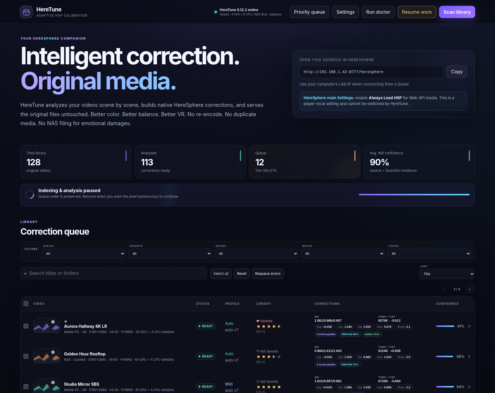
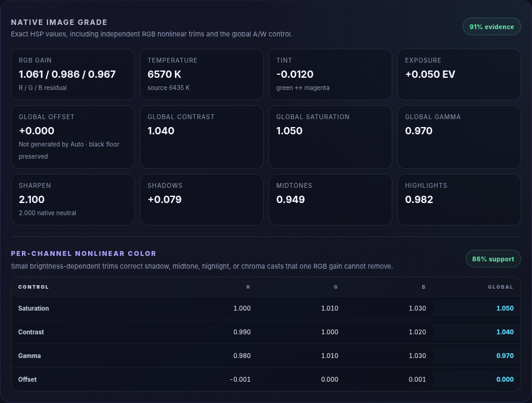
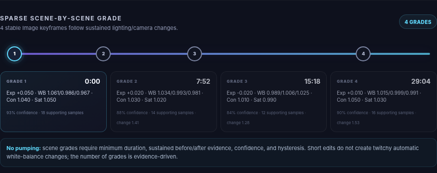
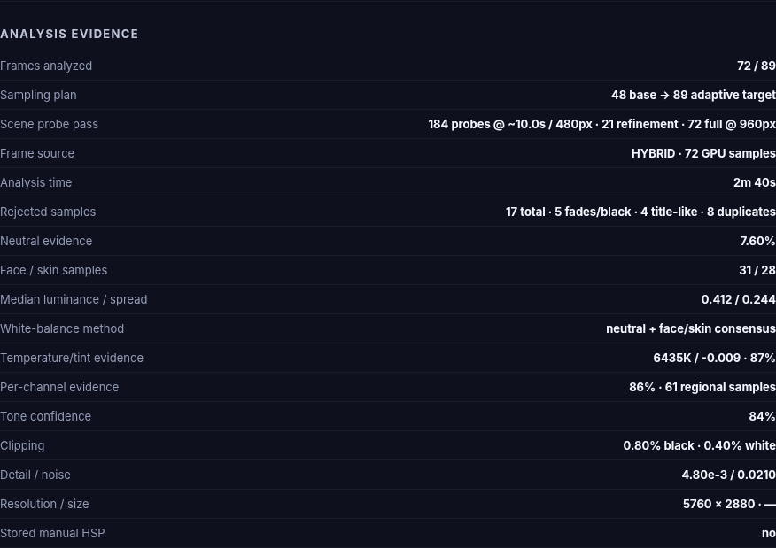
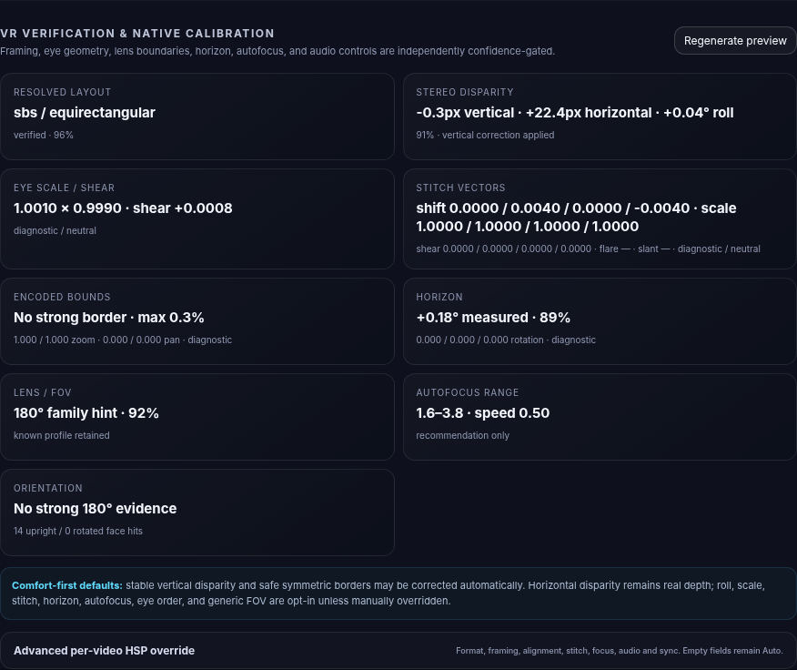

# HereTune

**Adaptive HSP Calibration for HereSphere**

> **Intelligent correction. Original media.**
>
> HereTune analyzes your videos scene by scene, builds native HereSphere corrections, and serves the original files untouched. Better color. Better balance. Better VR. No re-encode. No duplicate media. No NAS filing for emotional damages.

HereTune is an independent, community-built companion for **HereSphere VR Video Player**. It is **not affiliated with, endorsed by, sponsored by, or developed by HereSphere**. HereTune does not ship HereSphere binaries, PAK content, saved user data, or other proprietary HereSphere assets. You still need HereSphere. Shocking, I know.

**Project home:** [https://github.com/DaveTheAve/HereTune](https://github.com/DaveTheAve/HereTune) · Issues, releases, source, and current documentation live there.

---

## Screenshots

### Dashboard



### Video details highlights

| Section | Screenshot |
|---|---|
| Native image grade & per-channel nonlinear color |  |
| Sparse scene-by-scene grade |  |
| Analysis evidence |  |
| VR verification & native calibration |  |

---

## What HereTune does

HereTune watches one or more local folders, attached drives, UNC shares, or NAS-hosted media roots as a single library, analyzes representative frames, detects sustained scene/lighting changes, and generates native **HSP v7** corrections that HereSphere can apply during playback.

The important part:

**HereTune does not re-encode your source movie.**

Your enormous VR file remains exactly where it was, exactly as large as it was, judging your storage decisions in complete silence.

HereTune currently provides:

- white-balance analysis using neutral and face/skin evidence;
- temperature/tint plus RGB residual gain;
- exposure, contrast, gamma, saturation, shadows/midtones/highlights, sharpening, and small RGB trims;
- an **offset-free tone solver**: Auto Global Offset is disabled by default and never participates in Gamma/Midtones/Contrast calculation;
- small per-channel nonlinear finishing trims;
- sparse scene-by-scene HSP Image keyframes for sustained grading changes;
- fade/black/title-like/duplicate sample rejection;
- stereo packing/projection verification and conservative native calibration evidence;
- vertical stereo disparity, eye roll/scale/shear, stitch vectors, crop/border, horizon, orientation, eye order, lens/FOV, and autofocus diagnostics;
- audio loudness and A/V timing evidence;
- HereSphere favorites and half-star ratings;
- original-media byte-range streaming;
- browser playback plus monitor-friendly VR-to-2D previews;
- checkpoint-resumable analysis, run history, duplicate-media hints, Doctor diagnostics, and Library Health;
- optional managed `.hsp` sidecars beside source videos, including retroactive background synchronization.

Native geometry/timing evidence is measured independently from HSP output. **Stereo disparity/alignment and safe encoded-border crop preserve the v0.13.0 defaults and remain confidence-gated ON.** Newly exposed native calibration outputs remain OFF globally until explicitly enabled under HereSphere & HSP policy. In each video’s **VR verification & native calibration** drawer, every suggestion also has a persistent **Global / On / Off** per-video control for quick headset A/B testing without changing the rest of the library; the **Global** choice remains confidence-gated, while an explicit per-video **On** bypasses the confidence threshold for that title so you can audition a lower-confidence suggestion; hard validity/range/projection checks and advanced numeric layout overrides remain authoritative. HereTune is supposed to improve VR, not encourage nausea.

---

## Status

**Current public release: v0.13.1**

The public analysis revision is `offset-free-tone-1`.

This is not called 1.0 because naming something 1.0 is so 90s.

The standalone HSP writer is validated against the current v7 format knowledge used by this project, including native HereSphere exports and a large saved-profile dataset. Unknown future HereSphere formats remain unknown on purpose.

---

## Requirements

- Windows 10/11
- Python **3.11–3.13**
- FFmpeg + FFprobe
- HereSphere VR Video Player
- one or more media folders/shares reachable from the Windows machine running HereTune

### GPU acceleration

NVIDIA/CUDA/NVDEC is optional. `execution_mode = "auto"` prefers Hybrid when a working CUDA path is available and falls back to CPU when it is not.

No GPU? HereTune still works. Your CPU will simply receive a strongly worded calendar invitation.

---

## Five-minute install

1. Download and extract the release ZIP.
2. Install **Python 3.11+** if needed.
3. Install FFmpeg and ensure `ffmpeg` / `ffprobe` are on `PATH` (or configure full paths later).
4. Run:

   ```text
   install.bat
   ```

5. Then run:

   ```text
   start_heretune.bat
   ```

6. Open:

   ```text
   http://localhost:8777/
   ```

`install.bat` creates a project-local `.venv` inside the HereTune folder. It does not reorganize your global Python installation like a raccoon with administrator privileges.

For every configuration option, see [`docs/CONFIGURATION.md`](docs/CONFIGURATION.md).

---

## First-run setup

A fresh install ships with no media roots. The first-run wizard walks through:

1. **Media folders** — one or many local paths / UNC shares, for example:

   ```text
   D:\VR
   E:\Movies
   \\MEDIA-PC\VR
   \\NAS\Media\VR
   ```

2. **Analysis preset** — a sensible starting performance/coverage profile.
3. **FFmpeg / FFprobe checks**.
4. **HereSphere connection instructions**.
5. A short guided dashboard tour.

All roots appear as one HereTune library, but each source remains where it already lives. If one network root is temporarily offline, HereTune does not declare that root's entire catalog missing while other roots remain reachable.

By default work starts paused:

```toml
[server]
start_paused = true
```

Click **Resume work** when you are ready for scanning/analysis to begin.

---

## HereSphere setup

HereTune exposes a HereSphere Web API endpoint on the dashboard, normally:

```text
http://YOUR-PC-IP:8777/heresphere
```

Add that URL as a Web API library in HereSphere, then enable **Always Load HSP** in HereSphere's main settings.

### Browse-time safety

By default, HereTune advertises only videos whose analysis and Auto/accepted Manual HSP are ready:

```toml
[server]
heresphere_ready_only = true
```

HereTune also **does not advertise `hspArray` during metadata-only library browsing**. The selected HSP is supplied only when HereSphere makes the actual playback/media-source request. This avoids making the player parse native HSPs merely because you scrolled through a library.

During testing, native HereSphere/UE4 crashes were observed while browsing a Web API library that caused profiles to be parsed outside actual playback. The exact internal HereSphere failure is not established, so this is a conservative integration rule rather than a claim about every HereSphere build. See [`docs/TROUBLESHOOTING.md`](docs/TROUBLESHOOTING.md) and the API references for details.

### Compact library labels

If long folder names do not fit HereSphere's library navigation, enable:

```toml
[server]
compact_heresphere_library_labels = true
```

Compact mode presents:

```text
♥
All
A
B
C
...
```

Favorites and All remain recognizable; real folder groups consume the alphabetical aliases. The mapping is generated per API response and is not stored in a file or database.

---

## Auto HSP image policy

Headset A/B testing showed that additive lower-tone controls can create a gray/hazy veil on some sources. HereTune therefore separates **analysis evidence** from **what Auto is allowed to serialize into the player-facing HSP**.

The shipped policy is intentionally selective rather than broadly timid:

- **Global Offset: OFF and outside analysis** — the analyzer/tone solver never uses it. Gamma, Midtones, Contrast, scene detection, and other corrections are solved as though it does not exist. A deliberate Force On can serialize only a separately bounded output suggestion.
- **Shadows: OFF by default** — the suggested value is still measured and stored, so an individual video can Force On without re-analysis.
- **Midtones, Highlights, Gamma, Contrast, Saturation, RGB trims, Exposure, white balance, sharpening, and sparse scene grades remain enabled by default.**

Every supported Auto control has a global switch under **Settings → HereSphere & HSP policy**. Every video also supports **Inherit global / Force On / Force Off**. Policy changes rebuild HSP bytes from saved analysis evidence; they do not decode the movie again.

The optional HSP isolation tools remain available for temporary headset A/B testing and are hidden by default.

Player-facing sparse Image arrays are canonicalized, deduplicated, and capped at **64 keyframes**. Complete scene evidence remains stored in HereTune; the cap applies only to the native HSP handed to the player.

---

## HSP import/write-back safety

HereSphere can optionally POST imported or edited HSP bytes back to a Web API. HereTune keeps this **OFF by default**:

```toml
[hsp]
accept_hsp_writebacks = false
```

Favorites and ratings remain writable independently.

When HSP persistence is enabled, HereTune validates standalone structure, timeline, and numeric ranges before storage. Mutation acknowledgements intentionally contain no media or HSP URL, and another player-facing HSP load is withheld until the active playback closes.

For manual `.hsp` import/replacement testing, close the target video before importing or replacing its profile, then reopen playback.

---

## Optional HSP files beside videos

HereTune can keep its current Auto HSP beside each source as `<video-stem>.hsp`:

```toml
[hsp]
write_auto_sidecars = true
```

You can also export one title from its video drawer.

When enabled globally, existing Ready videos are synchronized retroactively in a separate background job. The dashboard work strip shows count, percentage, ETA, created/current/conflict/deferred/error totals. This does **not** enter or reorder the analysis queue.

Sidecar writes are atomic and playback-safe validated. Unknown/user-owned HSP files are never silently overwritten. Videos currently open in HereSphere are deferred until safe. Turning global synchronization off stops future writes but does not delete sidecars already created.

Use either HereTune-managed sidecars or HereSphere's own automatic sidecar writer for the same files—not both. Two programs racing to replace the same profile is less “redundancy” and more “storage-based improv comedy.”

---

## Why HSP instead of transcoding?

Because transcoding a huge VR library just to move white balance three percent to the left is ridiculous when the player already has native controls for the job.

```text
Original video on disk/NAS
        │
        ├── representative frame analysis
        │
        └── native HSP v7 profile
                  │
                  └── HereSphere renders correction during playback
```

No corrected duplicate movie is created.

---

## Scene-by-scene correction without color pumping

HereTune does **not** perform continuous frame-by-frame automatic white balance.

It uses:

- low-cost dense timeline probes;
- candidate boundary detection and refinement;
- minimum stable duration;
- persistence + hysteresis;
- confidence thresholds;
- expensive full analysis only where it adds useful evidence.

A movie with seven genuinely different sustained grading states may get seven Image keyframes. Seven quick edit cuts under identical lighting should not.

`scene_max_keyframes = 0` and `max_samples = 0` mean unlimited. Zero does not secretly mean 48. This rule has tests because apparently integers require adult supervision.

---

## Analysis cache: statistics, not screenshots

The checkpoint cache stores compact analysis statistics so interrupted jobs can resume. It does **not** store per-sample analysis JPEGs.

Inspector/rejected-sample images are generated on demand by seeking the original media. One normal library thumbnail per video is stored because rendering your entire NAS every time the table scrolls would be performance art, not software.

---

## Dashboard highlights

### Analysis Inspector

Open a Ready video to inspect scene probes, refined boundaries, accepted/rejected samples, confidence, sparse scene grades, native HSP vectors, VR/layout evidence, audio evidence, duplicate candidates, and run history.

### Priority queue

Priority requests are **FIFO**. Newly prioritized videos append behind existing priority work unless you deliberately reorder them in the Priority Queue dialog.

### Doctor + Library Health

Doctor covers Python/FFmpeg/OpenCV, CUDA/NVDEC, HSP serialization, library reachability, database integrity, cache/storage sizes, backups, VACUUM, and safe cleanup operations.

There is no tiny white coat icon. Restraint was exercised.

---

## Network, security, and privacy

HereTune listens on `0.0.0.0` by default because a headset on your LAN needs to reach it.

**Do not expose HereTune directly to the public Internet.** It is designed for a trusted private network.

Optional dashboard HTTP Basic authentication and separate HereSphere Web API credentials are available. Source deletion is disabled by default. See [`SECURITY.md`](SECURITY.md) and [`docs/CONFIGURATION.md`](docs/CONFIGURATION.md).

Analysis is local. HereTune includes no telemetry/analytics client and does not upload your library to a HereTune service. Runtime data may contain media paths/titles, SQLite analysis records, thumbnails, checkpoint statistics, logs, and database backups. Sanitize diagnostics before posting them publicly. If a folder name would embarrass you on a conference-room projector, assume it can eventually appear in a log.

---

## Documentation

The public repository intentionally keeps only documentation that is useful to users or HereSphere developers:

- [`CONFIGURATION.md`](docs/CONFIGURATION.md) — settings, defaults, presets, paths, and environment overrides.
- [`TROUBLESHOOTING.md`](docs/TROUBLESHOOTING.md) — installation, analysis, NAS, browser playback, HSP, and HereSphere crash guidance.
- [`HERESPHERE_API_QUICK_REFERENCE.md`](docs/HERESPHERE_API_QUICK_REFERENCE.md) — concise Web API/HSP developer reference.
- [`HERESPHERE_API_REFERENCE.md`](docs/HERESPHERE_API_REFERENCE.md) — detailed evidence-labeled API and HSP v7 serialization reference.
- [`HERESPHERE_MODDING_AND_CUSTOMIZATION_GUIDE.md`](docs/HERESPHERE_MODDING_AND_CUSTOMIZATION_GUIDE.md) — unofficial non-Web-API customization/modding guide.

The API/modding documents distinguish documented, observed, inferred/experimental, and unknown behavior rather than presenting reverse-engineering guesses as contracts.

---

## Configuration file

The repository contains exactly one config template:

```text
config.example.toml
```

The installer creates `config.toml` on first run. `config.toml`, `data/`, databases, logs, thumbnails, and runtime caches are ignored and must not be committed.

Useful environment overrides include:

```text
HERETUNE_LIBRARY
HERETUNE_PORT
HERETUNE_PUBLIC_BASE_URL
```

See [`docs/CONFIGURATION.md`](docs/CONFIGURATION.md) for the complete reference.

---

## Source-available license (noncommercial)

HereTune is publicly **source-available**, but intentionally **not OSI-open-source**, because third-party commercial use is restricted.

The repository uses the **PolyForm Noncommercial License 1.0.0**. Noncommercial use, modification, and redistribution are allowed within its terms. The copyright holder retains commercial rights and may grant separate commercial permission/licenses.

See [`LICENSE`](LICENSE), [`COMMERCIAL_USE.md`](COMMERCIAL_USE.md), and [`THIRD_PARTY_NOTICES.md`](THIRD_PARTY_NOTICES.md).

Contributors also agree to the grant in [`CONTRIBUTOR_LICENSE_AGREEMENT.md`](CONTRIBUTOR_LICENSE_AGREEMENT.md), allowing the project owner to continue commercially using/licensing the complete project after accepting contributions.

Yes, software found a way to make “thanks for the pull request” require paperwork.

---

## Contributing and coding agents

Read:

- [`CONTRIBUTING.md`](CONTRIBUTING.md)
- [`AGENTS.md`](AGENTS.md)
- [`CODE_OF_CONDUCT.md`](CODE_OF_CONDUCT.md)

`AGENTS.md` exists because HSP serialization, zero-as-unlimited semantics, player safety, and media identity are exactly the sort of details an AI coding agent can “helpfully simplify” into a regression.

Every PR is expected to pass Windows CI across Python 3.11, 3.12, and 3.13, the full test suite, Python compilation, JavaScript syntax checks, and release-hygiene validation.

---

## Release packaging

Tagged releases build:

```text
HereTune-vX.Y.Z.zip
heretune-X.Y.Z-py3-none-any.whl
HereTune-vX.Y.Z-SHA256.txt
```

The release audit rejects runtime databases/data folders, private paths, extra config variants, stale development documentation, inconsistent version strings, and other things that should remain on the machine where they were born.

Paranoia is just unit testing wearing a trench coat.

---

## Sacred laws

1. **Do not re-encode the movie if the player can perform the correction.**
2. **Do not let one beige wall convince us everyone is medically orange.**
3. **Do not overwrite unrelated HSP groups because you happen to know how to serialize them.**
4. **Do not invent a future HSP layout because `struct.pack()` made you feel powerful.**
5. **Zero means unlimited where the UI says zero means unlimited.**
6. **One video may fail. The queue may not have an existential crisis about it.**
7. **Do not cache hundreds of analysis JPEGs per movie merely because disks are technically capable of suffering.**
8. **Do not advertise HSPs during ordinary library browsing.** Native profile loading belongs to actual playback.
9. **When evidence is ambiguous, say so.** “Unknown” is a feature when the alternative is confidently rotating somebody's VR camera into the ceiling.

---

## Name origin

**HereTune**, because “Automated Native HereSphere Per-Asset Chromatic Compensation Middleware” sounded like something IBM would license for $8,000 per CPU core.

Enjoy your videos. Your NAS may thank you but probably not.
